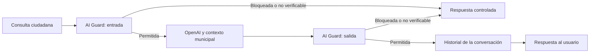
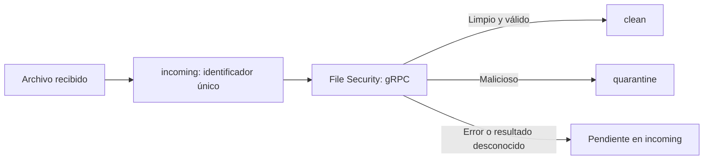

# Arquitectura de seguridad

La demo combina protección durante el uso del portal y análisis durante el desarrollo. El backend mantiene las decisiones de negocio y delega las inspecciones en los adaptadores de AI Guard y File Security.

## Chat

La política estricta no permite avanzar si AI Guard devuelve un error o un contrato desconocido. El modo permisivo es una opción explícita de demostración y se muestra como degradado; las respuestas no verificadas no se guardan en el historial.

Las sesiones son efímeras, limitadas y aisladas por token. El despliegue utiliza una réplica; estos tokens no sustituyen autenticación ni permisos sobre expedientes reales.

## Documentos

Se limita el tamaño de la carga antes del parser multipart y durante la copia del archivo. El nombre aportado por el usuario no se utiliza como ruta. El servicio de escaneo se invoca desde una ruta síncrona ejecutada fuera del bucle asíncrono.

## Desarrollo y operación

Los workflows locales validan backend y frontend, y preparan escaneos TMAS de repositorio e imágenes de la revisión. El arranque oficial construye imágenes locales identificadas por contenido. Las bases se fijan por digest y las dependencias por lockfile.

Los secretos se generan en `.runtime/secrets/`; los originales retirados permanecen en `.local/`, fuera de Git. Los eventos operativos se guardan en SQLite sin prompts ni respuestas. Los contenedores se ejecutan sin privilegios y disponen de probes y recursos limitados.

Más detalles: [AI Guard](TREND_AI_GUARD_DEPLOYMENT.md), [File Security](TREND_FILE_SECURITY_DEPLOYMENT.md), [TMAS](TREND_TMAS_CICD.md) y [operación del entorno](../overview/OPERACION_DEMO.md).
